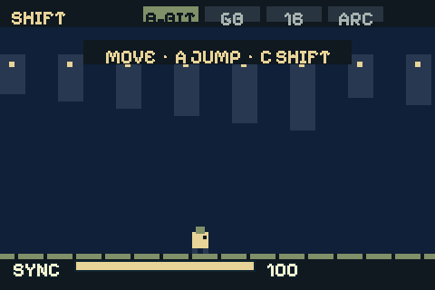
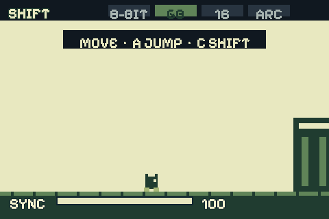
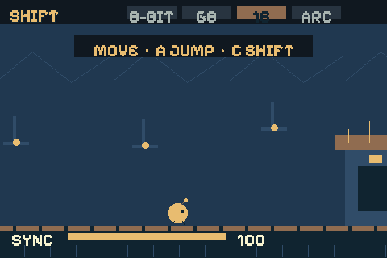
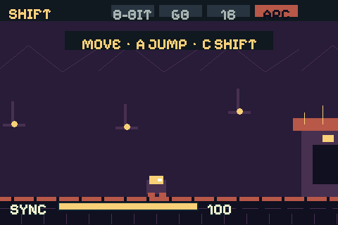
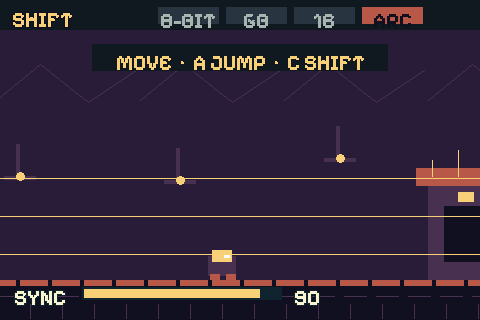
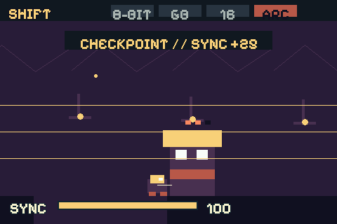
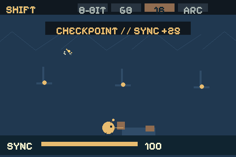

# SHIFT

Playable vertical slice for Pinyol/Cirera. NODI crosses one continuous sector; each era changes world rules, movement, shapes and sound.

## Play

From `pinyol-engine/pinyol`:

```sh
./build/pinyol_sim --game games/shift
```

Arrows: move. A: jump. C: shift through unlocked eras. B: activate switch or attack in Arcade. Touch: swipe left/right to shift; tap era strip to select. START: show debug coordinates. The boot is short; press nothing until control prompt appears.

Desktop uses same simulator. Browser player and Cirera use standard Pinyol packaging:

```sh
python3 tools/pack_game.py games/shift -o dist/
emcmake cmake -B build-web -DCMAKE_BUILD_TYPE=Release
cmake --build build-web --target pinyol_player
cp dist/shift.zip build-web/
# Open player.html?game=shift.zip from build-web
uv run --with pyserial tools/send_game.py games/shift
```

## Check

```sh
./build/pinyol_headless --game games/shift --fresh --script games/shift/tests/shift.script --check-strips --strict-assets
./build/pinyol_headless --game games/shift --validate --strict-assets
```

See [SHIFT_DESIGN.md](SHIFT_DESIGN.md), [SHIFT_TECH.md](SHIFT_TECH.md), and [SHIFT_TODO.md](SHIFT_TODO.md). No generated art, external assets, or new engine APIs required.

## Screenshots

Same room, four interpretations:

| 8-bit | Game Boy | 16-bit | Arcade |
|---|---|---|---|
|  |  |  |  |

Combat and route:

| Shift transition | Guardian hit | Multi-era route |
|---|---|---|
|  |  |  |
